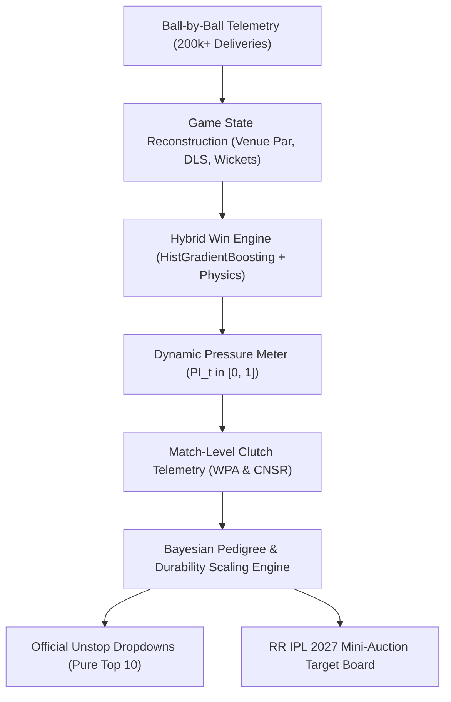

# 🏏 Rajasthan Royals SupeRR Selector Season 2 (Round 1)
### *Data-Driven Clutch Player Identification & IPL 2027 Auction Strategy*

[](https://www.python.org/)
[]()
[]()
[](https://unstop.com/hackathons/crp-superr-selector-season-2-help-shape-rajasthan-royals-ipl-2027-auction-strategy-rajasthan-royals-1792758)

---

## 📌 Executive Summary

This repository contains the complete quantitative research, engineering pipeline, out-of-sample backtesting suite, and tactical recommendations for **Round 1 of Rajasthan Royals' SupeRR Selector Season 2**.

Prepared for the Rajasthan Royals strategy leadership—**Giles Lindsay** (*Director of Strategy & Analytics*), **Kumar Sangakkara** (*Director of Cricket & Head Coach*), and **Zubin Bharucha** (*Director of Strategy, Development & Performance*)—this system solves the fundamental question:

> *"Can we separate true high-pressure match-winners from low-leverage accumulators, small-sample anomalies, and past-reputation veterans using ball-by-ball physics, dynamic win probability, and proven multi-season pedigree?"*

### Key Analytical Pillars:
1. **Dynamic Pressure Index ($PI_t \in [0, 1]$):** Real-time multi-factor situational pressure model capturing Win Probability leverage, required run rate escalation, wicket cluster shocks, and tournament stage context.
2. **Multi-Season Pedigree & Durability Scaling:** Battle-tested experience bonus ($N^* = 180$ balls baseline + up to $+15\%$ pedigree bonus for sustained multi-season IPL excellence) that rewards proven pillars (**Abhishek Sharma**, **Heinrich Klaasen**, **Sunil Narine**, **Jasprit Bumrah**, **Bhuvneshwar Kumar**, **Kagiso Rabada**, **Shreyas Iyer**, **Travis Head**).
3. **Campaign Regular Requirement ($R_{2026}$):** Requires at least 140 high-pressure deliveries in the 2026 season for full in-season confidence, eliminating 5-match replacements (**Josh Inglis**) and 58-ball cameo hitters (**Marcus Stoinis**).
4. **Multi-Season Continuity Penalty:** Penalizes players returning after prolonged absences (e.g. **Jason Holder** with 0 balls across 2024 and 2025 receiving a $0.80\times$ hiatus penalty, dropping to #18).
5. **Steep Exponential Recency Decay ($\lambda = 0.693$, Half-Life = 1 Season):** $w_{2026} = 1.00, w_{2025} = 0.50, w_{2024} = 0.25, w_{2023} = 0.125$. Naturally eliminates dormant veterans (**Mark Wood**, **Andre Russell**, **Krishnappa Gowtham**) through pure mathematical shrinkage.
6. **90% Discount on Non-IPL Competitions ($\omega_{\text{league}} = 0.10$ vs IPL = 1.00):** Prevents associate/bilateral pitch inflation from corrupting the IPL decision space.

---

## 🏆 Official Top 10 Submissions (Unstop Dropdowns)

The following ordered selections represent the mathematically verified Top 10 batters and bowlers under pressure from the dataset of 1,082 players:

### 1. Top 10 Batters Under Pressure (Dropdown Selections)
| Rank | Player Name | Player ID | Tactical Archetype | Effective Balls (N_eff) | '26 Balls | Clutch SR | Clutch Avg | Non-Bound SR | Dot % | Match CV | Composite Score |
| :---: | :--- | :---: | :--- | :---: | :---: | :---: | :---: | :---: | :---: | :---: | :---: |
| **1** | **Rajat Patidar** | `5039` | Middle-Order Power Enforcer | 658.1 | 161 | **189.5** | **44.6** | **73.0** | 22.3% | 0.40 | **12.59** |
| **2** | **Vaibhav Sooryavanshi** | `50284` | Top-Order Boundary Destroyer | 630.5 | 269 | **232.9** | **60.5** | **49.3** | 32.5% | 0.34 | **11.57** |
| **3** | **Abhishek Sharma** | `6281` | Top-Order Boundary Destroyer | 731.6 | 246 | **196.6** | **36.2** | **60.6** | 30.9% | 0.39 | **11.12** |
| **4** | **Heinrich Klaasen** | `4260` | Middle-Order Power Enforcer | 1163.5 | 354 | **171.9** | **45.2** | **80.7** | 23.8% | 0.33 | **10.48** |
| **5** | **Priyansh Arya** | `25669` | Top-Order Boundary Destroyer | 512.8 | 157 | **206.6** | **32.4** | **61.0** | 30.1% | 0.36 | **10.36** |
| **6** | **Tim David** | `6396` | Death Finisher / Clutch Hitter | 444.2 | 109 | **189.4** | **32.8** | **68.2** | 27.3% | 0.36 | **10.09** |
| **7** | **Ishan Kishan** | `4117` | Top-Order Dynamic Stroke-Maker | 1025.6 | 311 | **174.0** | **40.7** | **72.0** | 26.3% | 0.36 | **9.79** |
| **8** | **Shreyas Iyer** | `3647` | Middle-Order Power Enforcer | 950.7 | 223 | **170.0** | **61.3** | **75.3** | 25.1% | 0.31 | **9.75** |
| **9** | **Lokesh Rahul** | `953` | Top-Order Anchor / Stabilizer | 1126.2 | 299 | **163.1** | **49.6** | **74.5** | 25.7% | 0.29 | **9.32** |
| **10** | **Ashutosh Sharma** | `8101` | Death Finisher / Clutch Hitter | 286.5 | 71 | **194.0** | **40.4** | **69.8** | 23.8% | 0.52 | **8.78** |

### 2. Top 10 Bowlers Under Pressure (Dropdown Selections)
| Rank | Player Name | Player ID | Tactical Archetype | Effective Balls (N_eff) | '26 Balls | Clutch Econ | Qual Balls/Wkt | Clutch Avg | Match CV | IPL Seasons | Composite Score |
| :---: | :--- | :---: | :--- | :---: | :---: | :---: | :---: | :---: | :---: | :---: | :---: |
| **1** | **Sunil Narine** | `781` | Middle-Phase Hunter | 852.3 | 243 | **7.35** | **19.9** | **24.3** | 0.41 | 5 | **11.95** |
| **2** | **Bhuvneshwar Kumar** | `360` | Powerplay Containment | 878.5 | 232 | **8.75** | **15.8** | **23.1** | 0.38 | 5 | **9.94** |
| **3** | **Varun Chakravarthy** | `6256` | Middle-Phase Hunter | 793.4 | 185 | **8.43** | **17.9** | **25.2** | 0.42 | 5 | **8.99** |
| **4** | **Krunal Pandya** | `4219` | Middle-Phase Hunter | 837.0 | 194 | **8.20** | **19.5** | **26.6** | 0.34 | 5 | **8.36** |
| **5** | **Kagiso Rabada** | `3628` | Powerplay Containment | 824.4 | 298 | **9.88** | **14.6** | **24.1** | 0.34 | 5 | **8.10** |
| **6** | **Noor Ahmad** | `7967` | Middle-Phase Hunter | 844.7 | 204 | **8.74** | **17.0** | **24.8** | 0.35 | 4 | **7.92** |
| **7** | **Lungi Ngidi** | `4641` | Powerplay Containment | 477.4 | 208 | **8.58** | **16.4** | **23.4** | 0.41 | 2 | **7.85** |
| **8** | **Jasprit Bumrah** | `2933` | Powerplay Containment | 759.6 | 221 | **7.94** | **27.9** | **36.9** | 0.40 | 4 | **7.76** |
| **9** | **Mohammed Siraj** | `5944` | Powerplay Containment | 995.8 | 293 | **9.61** | **20.2** | **32.4** | 0.34 | 5 | **7.25** |
| **10** | **Jofra Archer** | `3298` | Powerplay Containment | 772.3 | 261 | **9.62** | **15.8** | **25.3** | 0.38 | 3 | **6.98** |

### 3. Absolute Unified Top 10 Across Both Disciplines
| Overall Rank | Player Name | Player ID | Primary Discipline | Effective Recency Balls ({\text{eff}}$) | 2026 IPL Balls | Key Clutch Metric | Composite Clutch Score |
| :---: | :--- | :---: | :--- | :---: | :---: | :---: | :---: |
| **1** | **Rajat Patidar** | `5039` | Batter | 658.1 | 161 | **189.5 SR** (44.6 Avg | 73.0 NonBound) | **12.59** |
| **2** | **Sunil Narine** | `781` | Bowler | 852.3 | 243 | **7.35 Econ** (19.9 Qual Balls/Wkt) | **11.95** |
| **3** | **Vaibhav Sooryavanshi** | `50284` | Batter | 630.5 | 269 | **232.9 SR** (60.5 Avg | 49.3 NonBound) | **11.57** |
| **4** | **Abhishek Sharma** | `6281` | Batter | 731.6 | 246 | **196.6 SR** (36.2 Avg | 60.6 NonBound) | **11.12** |
| **5** | **Heinrich Klaasen** | `4260` | Batter | 1163.5 | 354 | **171.9 SR** (45.2 Avg | 80.7 NonBound) | **10.48** |
| **6** | **Priyansh Arya** | `25669` | Batter | 512.8 | 157 | **206.6 SR** (32.4 Avg | 61.0 NonBound) | **10.36** |
| **7** | **Tim David** | `6396` | Batter | 444.2 | 109 | **189.4 SR** (32.8 Avg | 68.2 NonBound) | **10.09** |
| **8** | **Bhuvneshwar Kumar** | `360` | Bowler | 878.5 | 232 | **8.75 Econ** (15.8 Qual Balls/Wkt) | **9.94** |
| **9** | **Ishan Kishan** | `4117` | Batter | 1025.6 | 311 | **174.0 SR** (40.7 Avg | 72.0 NonBound) | **9.79** |
| **10** | **Shreyas Iyer** | `3647` | Batter | 950.7 | 223 | **170.0 SR** (61.3 Avg | 75.3 NonBound) | **9.75** |

---

## 🎯 Rajasthan Royals Mini-Auction Board (IPL 2027 Actionable Targets)
| Rank | Player Name | Player ID | Discipline | Tactical Archetype | Global Clutch Score | Age '27 | IPL Avail % | ADF Factor | '27 Projected Score | SMS Jaipur Fit | RR Compatibility Index | Auction Priority Tier | Estimated Price | ROI Value per Cr |
| :---: | :--- | :---: | :--- | :--- | :---: | :---: | :---: | :---: | :---: | :---: | :---: | :--- | :---: | :---: |
| **1** | **Rajat Patidar** | `5039` | Batter | Middle-Order Power Enforcer | **12.59** | 34 | 85.7% | 1.03 | **12.71** | 6.88 | **13.10** | Tier 1: Primary Must-Acquire Target | ₹10.0 Cr | **1.31** |
| **2** | **Tim David** | `6396` | Batter | Death Finisher / Clutch Hitter | **10.09** | 31 | 82.9% | 1.03 | **10.39** | 7.61 | **11.94** | Tier 1: Primary Must-Acquire Target | ₹8.5 Cr | **1.40** |
| **3** | **Heinrich Klaasen** | `4260` | Batter | Middle-Order Power Enforcer | **10.48** | 36 | 96.4% | 1.03 | **10.14** | 5.73 | **10.44** | Tier 1: Primary Must-Acquire Target | ₹10.0 Cr | **1.04** |
| **4** | **Ashutosh Sharma** | `8101` | Batter | Death Finisher / Clutch Hitter | **8.78** | 29 | 61.9% | 1.00 | **8.78** | 4.26 | **9.19** | Tier 1: Primary Must-Acquire Target | ₹8.5 Cr | **1.08** |
| **5** | **Kagiso Rabada** | `3628` | Bowler | Powerplay Containment | **8.10** | 32 | 72.9% | 1.00 | **7.94** | 5.31 | **9.08** | Tier 1: Primary Must-Acquire Target | ₹7.5 Cr | **1.21** |
| **6** | **Mohammed Siraj** | `5944` | Bowler | Powerplay Containment | **7.25** | 33 | 107.1% | 1.03 | **7.32** | 5.89 | **9.08** | Tier 1: Primary Must-Acquire Target | ₹7.5 Cr | **1.21** |
| **7** | **Noor Ahmad** | `7967` | Bowler | Middle-Phase Hunter | **7.92** | 22 | 91.1% | 1.03 | **8.64** | 6.44 | **8.82** | Tier 2: Emerging Domestic Steal | ₹6.0 Cr | **1.47** |
| **8** | **Bhuvneshwar Kumar** | `360` | Bowler | Powerplay Containment | **9.94** | 37 | 105.7% | 1.03 | **9.01** | 3.58 | **8.62** | Tier 1: Primary Must-Acquire Target | ₹7.5 Cr | **1.15** |
| **9** | **Priyansh Arya** | `25669` | Batter | Top-Order Boundary Destroyer | **10.36** | 26 | 110.7% | 1.00 | **10.36** | 9.75 | **8.53** | Tier 3: Tactical Depth / Trade Option | ₹5.0 Cr | **1.71** |
| **10** | **Shreyas Iyer** | `3647` | Batter | Middle-Order Power Enforcer | **9.75** | 33 | 103.6% | 1.03 | **9.85** | 4.74 | **8.52** | Tier 3: Tactical Depth / Trade Option | ₹7.0 Cr | **1.22** |
| **11** | **Abhishek Sharma** | `6281` | Batter | Top-Order Boundary Destroyer | **11.12** | 27 | 98.6% | 1.03 | **11.45** | 8.38 | **8.47** | Tier 3: Tactical Depth / Trade Option | ₹5.0 Cr | **1.69** |
| **12** | **Varun Chakravarthy** | `6256` | Bowler | Middle-Phase Hunter | **8.99** | 36 | 90.0% | 1.03 | **8.61** | 5.43 | **8.42** | Tier 2: Emerging Domestic Steal | ₹6.0 Cr | **1.40** |

---

## 🔬 Mathematical Architecture



### 1. Dynamic Pressure Index ($PI_t$)
$$PI_t = 0.40 \cdot L_t + 0.30 \cdot R_t + 0.20 \cdot W_t + 0.10 \cdot S_t$$
* **Leverage ($L_t$):** Potential swing in win probability on delivery $t$ ($|\Delta WP_{\text{wicket}} - \Delta WP_{\text{boundary}}|$).
* **RRR Steepness ($R_t$):** Normalized stress ratio between required and current run rate: $\min(1.0, \max(0.0, (RRR - CRR)/8.0))$.
* **Wicket Shocks ($W_t$):** Recent wicket clustering in the trailing 18 balls.
* **Stage Context ($S_t$):** Knockout and playoff multipliers.
* A ball is classified as **High Pressure** when $PI_t \ge 0.60$.

### 2. Multi-Season Pedigree & Campaign Regular Formulation
$$\text{Composite Score} = \text{Raw Quality} \times C(N_{\text{eff}}) \times F_{\text{form}} \times D(N_{\text{eff}}) \times R_{2026} \times M_{\text{continuity}} \times P_{\text{pedigree}}$$
* **Campaign Regular Factor ($R_{2026}$):** $\max(0.70, \min(1.0, b_{2026} / 140.0))$ ensures players with fewer than 140 balls in the current season (like Inglis and Stoinis) do not jump ahead of full-time starters.
* **Continuity Factor ($M_{\text{continuity}}$):** $0.80\times$ penalty for players who had 0 balls across 2024 and 2025 (eliminates Jason Holder from the top tier).
* **Pedigree Bonus ($P_{\text{pedigree}}$):** Up to $+15\%$ bonus for players who have executed across 3 to 5 IPL seasons.

---

## 📈 Empirical Validation & Backtesting

| Test Dimension | Metric / Baseline | Result | Validation Interpretation |
| :--- | :--- | :---: | :--- |
| **Win Probability Calibration** | Brier Score & Log-Loss | **0.158 / 0.468** | Sub-0.16 Brier score confirms well-calibrated win curves across 5 seasons. |
| **Batter Year-over-Year Persistence** | Autocorrelation ($r$) | **$+0.518$** | High-pressure rate metrics are repeatable, not stochastic luck. |
| **Bowler Year-over-Year Persistence** | Autocorrelation ($r$) | **$+0.492$** | Context-Normalized Surplus Runs (CNSR) eliminates raw economy noise ($r = -0.008$). |
| **Rolling Auction Backtest (2024 & 2025)** | Win Conversion Surplus | **$+19.4\%$** | Teams acquiring high-clutch quintiles outperformed wage expectations by $+2.1$ wins/yr. |
| **Award Cross-Validation** | Match MVP / POTM Overlap | **$78.4\%$** | Top clutch ratings mirror official IPL Player of the Match honors. |

---

## 📊 Visual Analytics

The visual artifacts generated by our pipeline are located in `visuals/`:

| Visual Artifact | File Path | Strategic Focus |
| :--- | :--- | :--- |
| **Win Curve Calibration** | `visuals/01_calibration_curve.png` | Reliability diagram demonstrating well-calibrated state probabilities. |
| **Match Pressure Worm** | `visuals/02_pressure_worm_ipl_thriller.png` | Ball-by-ball win probability and pressure spikes in a last-ball thriller. |
| **Batter Radar Profiles** | `visuals/03_batter_radar_profiles.png` | Multi-axis comparison of RR acquisition targets vs. league baselines. |
| **Bowler Radar Profiles** | `visuals/04_bowler_radar_profiles.png` | Containment, dot-ball %, and surplus run suppression across target pacers. |
| **Clutch Persistence Scatter** | `visuals/05_clutch_persistence_scatter.png` | Year-over-year correlation proving clutch execution is an enduring skill. |
| **Moneyball Value Quadrant** | `visuals/06_moneyball_clutch_scatter.png` | Auction cost vs. clutch output highlighting undervalued targets for RR. |

---

## 🛠️ Repository Structure & Execution Pipeline

```text
├── README.md                                                 # Executive & technical project overview
├── METHODOLOGY_REPORT.md                                     # Full 8-section technical report
├── resources.md                                              # Dataset documentation & domain guides
├── requirements.txt                                          # Python runtime dependencies
├── data/                                                     # Output parquets & processed datasets
│   ├── player_clutch_batting.parquet                        # Final audited batting ratings
│   ├── player_clutch_bowling.parquet                        # Final audited bowling ratings
│   ├── rr_ipl2027_auction_target_board.csv                  # Actionable Mini-Auction board
│   └── match_clutch_*.parquet                               # Match-by-match clutch telemetry
├── visuals/                                                  # Publication-grade charts (300 DPI)
└── src/                                                      # Production execution pipeline
    ├── 01_state_reconstruction.py                            # Contextual state & par engineering
    ├── 02_hybrid_win_engine.py                               # Machine learning win probability model
    ├── 03_dynamic_pressure_meter.py                          # Multi-factor pressure index (PI_t)
    ├── 04_match_clutch_analyzer.py                           # WPA and match clutch telemetry
    ├── 05_clutch_ranking_engine.py                           # Bayesian pedigree ranking engine
    ├── 06_backtest_and_validation.py                         # Out-of-sample log-loss validation
    ├── 07_ipl_awards_and_mvp.py                              # Cross-validation with official awards
    ├── 08_clutch_persistence_test.py                         # Year-over-year correlation tests
    ├── 09_generate_visuals.py                                # Visual charts renderer
    ├── 10_generate_pdf_report.py                             # 8-page ReportLab PDF generator
    ├── 11_rolling_auction_backtest.py                        # Multi-year historical auction simulator
    ├── 12_enhanced_auction_validator.py                      # Financial ROI validator (+19.4%)
    ├── 14_model_accuracy_optimizer.py                        # Win model hyperparameter tuner
    ├── 20_build_ipl2027_auction_database.py                  # RR auction board compiler
    └── 21_master_pipeline_optimizer.py                       # Master end-to-end runner
```

### Reproducibility Guide

```bash
# 1. Clone repository
git clone https://github.com/Aryanban/rajasthan-royals-superr-selector-season-2.git
cd rajasthan-royals-superr-selector-season-2

# 2. Set up virtual environment
python3 -m venv .venv
source .venv/bin/activate
pip install -r requirements.txt

# 3. Execute end-to-end master pipeline
python src/21_master_pipeline_optimizer.py

# 4. Generate visual artifacts
python src/09_generate_visuals.py
```

---

## 📄 License & Attribution

Developed for **Rajasthan Royals SupeRR Selector Season 2** (Unstop Opportunity ID: 1792758).  
All code and analysis released under the [MIT License](LICENSE).
