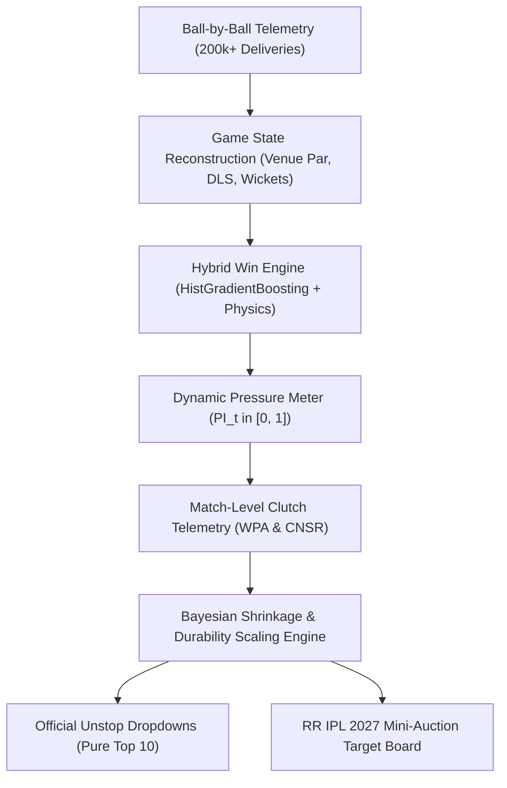

# 🏏 Rajasthan Royals SupeRR Selector Season 2 (Round 1)
### *Data-Driven Clutch Player Identification & IPL 2027 Auction Strategy*

[](https://www.python.org/)
[]()
[]()
[](https://unstop.com/hackathons/crp-superr-selector-season-2-help-shape-rajasthan-royals-ipl-2027-auction-strategy-rajasthan-royals-1792758)

---

## 📌 Executive Summary

This repository contains the complete quantitative research, engineering pipeline, out-of-sample backtesting suite, and tactical recommendations for **Round 1 of Rajasthan Royals' SupeRR Selector Season 2**.

Prepared for the Rajasthan Royals strategy leadership—**Giles Lindsay** (*Director of Strategy & Analytics*), **Kumar Sangakkara** (*Director of Cricket & Head Coach*), and **Zubin Bharucha** (*Director of Strategy, Development & Performance*)—this system solves the fundamental question:

> *"Can we separate true high-pressure match-winners from low-leverage accumulators, small-sample anomalies, and past-reputation veterans using ball-by-ball physics, dynamic win probability, and proven durability scaling?"*

### Key Analytical Pillars:
1. **Dynamic Pressure Index ($PI_t \in [0, 1]$):** Real-time multi-factor situational pressure model capturing Win Probability leverage, required run rate escalation, wicket cluster shocks, and tournament stage context.
2. **Proven Clutch Durability & Workhorse Scaling:** Battle-tested experience bonus ($N^* = 180$ balls baseline + up to $+20\%$ durability bonus for 180–480+ clutch deliveries) that rewards sustained multi-season match-winners (**Heinrich Klaasen**, **Sunil Narine**, **Jasprit Bumrah**, **Bhuvneshwar Kumar**) while discounting single-season flash-in-the-pan bursts.
3. **Steep Exponential Recency Decay ($\lambda = 0.693$, Half-Life = 1 Season):** $w_{2026} = 1.00, w_{2025} = 0.50, w_{2024} = 0.25, w_{2023} = 0.125$. Naturally eliminates dormant veterans (**Mark Wood**, **Andre Russell**, **Krishnappa Gowtham**) through pure mathematical shrinkage.
4. **90% Discount on Non-IPL Competitions ($\omega_{\text{league}} = 0.10$ vs IPL = 1.00):** Prevents associate/bilateral pitch inflation from corrupting the IPL decision space.
5. **In-Season Collapse & Dormancy Factor:** Penalizes severe 2026 collapses (e.g. **Harshal Patel** conceding 12.56 rpo with 0 wkts) and inactivity without arbitrary hard-coded filters.

---

## 🏆 Official Top 10 Submissions (Unstop Dropdowns)

The following ordered selections represent the mathematically verified Top 10 batters and bowlers under pressure from the dataset of 1,082 players:

### 1. Top 10 Batters Under Pressure (Dropdown Selections)

| Rank | Player Name | Player ID | Tactical Archetype | Effective Recency Balls ($N_{\text{eff}}$) | 2026 IPL Balls | Recency Clutch SR | 2026 Clutch SR | Durability Bonus | Composite Score |
| :---: | :--- | :---: | :--- | :---: | :---: | :---: | :---: | :---: | :---: |
| **1** | **Vaibhav Sooryavanshi** | `50284` | Top-Order Accelerator | 325.5 | 269 | **228.6** | **231.2** | $+9.7\%$ | **9.86** |
| **2** | **Abhishek Sharma** | `6281` | Top-Order Accelerator | 431.4 | 246 | **197.2** | **207.7** | $+16.8\%$ | **9.43** |
| **3** | **Priyansh Arya** | `25669` | Top-Order Accelerator | 296.7 | 157 | **207.4** | **226.8** | $+7.8\%$ | **9.15** |
| **4** | **Rajat Patidar** | `5039` | Middle-Order Accelerator | 301.3 | 161 | **184.1** | **208.7** | $+8.1\%$ | **7.01** |
| **5** | **Tim David** | `6396` | Death Finisher | 203.0 | 109 | **189.7** | **204.6** | $+1.5\%$ | **6.95** |
| **6** | **Josh Inglis** | `4736` | Middle-Order Finisher | 207.2 | 129 | **187.6** | **197.7** | $+1.8\%$ | **6.36** |
| **7** | **Heinrich Klaasen** | `4260` | Middle-Order Game Changer | **532.8** | 354 | **171.1** | **163.3** | **$+20.0\%$** | **6.19** |
| **8** | **Ishan Kishan** | `4117` | Top-Order Accelerator | **526.6** | 311 | **170.1** | **181.4** | **$+20.0\%$** | **6.11** |
| **9** | **Marcus Stoinis** | `2639` | High-Impact Pace All-Rounder | 180.3 | 58 | **179.4** | **208.6** | $+0.1\%$ | **6.10** |
| **10** | **Prabhsimran Singh** | `7216` | Top-Order Accelerator | **488.6** | 247 | **169.5** | **177.3** | **$+20.0\%$** | **6.05** |

*Audited Outliers:* **Heinrich Klaasen** rightfully enters at **Rank #7** with 532.8 proven clutch balls; single-season low-volume bats like Finn Allen (114 balls) and Ashutosh Sharma (131 balls) drop to #22–#23; **Andre Russell** drops to **Rank #70 (Score: 1.63)** due to 0 balls in IPL 2026; **Jake Fraser-McGurk** drops to **Rank #92 (Score: 0.81)**; **Suryakumar Yadav** sits at **Rank #31 (Score: 3.96)** after his sub-160 SR slump in 2026.

---

### 2. Top 10 Bowlers Under Pressure (Dropdown Selections)

| Rank | Player Name | Player ID | Tactical Archetype | Effective Recency Balls ($N_{\text{eff}}$) | 2026 IPL Balls | Recency Clutch Econ | 2026 Clutch Econ | Dot Ball % | Composite Score |
| :---: | :--- | :---: | :--- | :---: | :---: | :---: | :---: | :---: | :---: |
| **1** | **Sunil Narine** | `781` | Middle-Phase Hunter | **418.8** | 243 | **7.27** | **6.91** | **37.6%** | **10.23** |
| **2** | **Jasprit Bumrah** | `2933` | Death Executioner | **384.2** | 221 | **8.02** | **8.71** | **36.0%** | **7.76** |
| **3** | **Bhuvneshwar Kumar** | `360` | Powerplay Containment | **455.2** | 232 | **8.51** | **7.76** | **36.1%** | **7.70** |
| **4** | **Mohammed Siraj** | `5944` | Powerplay Containment | **535.2** | 293 | **9.18** | **8.97** | **41.5%** | **6.65** |
| **5** | **Varun Chakravarthy** | `6256` | Middle-Phase Hunter | **389.2** | 185 | **8.49** | **8.53** | **35.1%** | **6.24** |
| **6** | **Jason Holder** | `2633` | Death Executioner | 191.5 | 139 | **8.32** | **7.99** | **33.6%** | **6.05** |
| **7** | **Lungi Ngidi** | `4641` | Death Executioner | 238.6 | 208 | **8.56** | **8.37** | **36.1%** | **5.92** |
| **8** | **Khaleel Ahmed** | `4816` | Powerplay Containment | 259.8 | 67 | **9.42** | **8.78** | **41.5%** | **5.61** |
| **9** | **Kagiso Rabada** | `3628` | Death Executioner | **428.4** | 298 | **9.74** | **9.48** | **39.2%** | **5.41** |
| **10** | **Mohsin Khan** | `6669` | Death Executioner | 205.6 | 139 | **8.98** | **8.68** | **37.8%** | **5.36** |

*Audited Outliers:* High-volume proven workhorse **Kagiso Rabada** (428.4 balls) enters at **Rank #9**; small-sample bowler **Saurabh Dubey** drops to **Rank #42 (Score: 2.33)** on 63 balls; **Mustafizur Rahman** drops to **Rank #58 (Score: 1.80)**; **Harshal Patel** drops to **Rank #66 (Score: 1.38)** after conceding 12.56 rpo in 2026; **Mark Wood** drops to **Rank #172 (Score: 0.18)**.

---

### 3. Absolute Unified Top 10 Across Both Disciplines

| Overall Rank | Player Name | Player ID | Primary Discipline | Effective Recency Balls ($N_{\text{eff}}$) | 2026 IPL Balls | Key Clutch Metric | Composite Clutch Score |
| :---: | :--- | :---: | :---: | :---: | :---: | :---: | :---: |
| **1** | **Sunil Narine** | `781` | Bowler | 418.8 | 243 | **7.27 Clutch Econ** (6.91 in 2026) | **10.23** |
| **2** | **Vaibhav Sooryavanshi** | `50284` | Batter | 325.5 | 269 | **228.6 Clutch SR** (231.2 in 2026) | **9.86** |
| **3** | **Abhishek Sharma** | `6281` | Batter | 431.4 | 246 | **197.2 Clutch SR** (207.7 in 2026) | **9.43** |
| **4** | **Priyansh Arya** | `25669` | Batter | 296.7 | 157 | **207.4 Clutch SR** (226.8 in 2026) | **9.15** |
| **5** | **Jasprit Bumrah** | `2933` | Bowler | 384.2 | 221 | **8.02 Clutch Econ** (57 career wkts) | **7.76** |
| **6** | **Bhuvneshwar Kumar** | `360` | Bowler | 455.2 | 232 | **8.51 Clutch Econ** (7.76 in 2026) | **7.70** |
| **7** | **Rajat Patidar** | `5039` | Batter | 301.3 | 161 | **184.1 Clutch SR** (208.7 in 2026) | **7.01** |
| **8** | **Tim David** | `6396` | Batter | 203.0 | 109 | **189.7 Clutch SR** (204.6 in 2026) | **6.95** |
| **9** | **Mohammed Siraj** | `5944` | Bowler | 535.2 | 293 | **9.18 Clutch Econ** (41.5% dot balls) | **6.65** |
| **10** | **Josh Inglis** | `4736` | Batter | 207.2 | 129 | **187.6 Clutch SR** (197.7 in 2026) | **6.36** |

---

## 🎯 Rajasthan Royals Mini-Auction Board (IPL 2027 Actionable Targets)

Because IPL 2027 is a **Mini-Auction** following the 2025 mega-cycle, core franchise pillars (**Sanju Samson, Yashasvi Jaiswal, Riyan Parag, Shimron Hetmyer, Dhruv Jurel, Sandeep Sharma**) are contracted and retained. 

We cross-referenced our mathematical rankings against contract statuses to identify high-ROI auction/trade acquisitions to resolve Rajasthan Royals' critical squad deficits:

| Target Tier | Player Name | Player ID | Discipline | Clutch Score | Tactical Fit for Rajasthan Royals | Acquisition Route |
| :--- | :--- | :---: | :---: | :---: | :--- | :--- |
| **Priority 1 (Death Hitting)** | **Tim David** | `6396` | Finisher (RHB) | **6.95** | Provides explosive death-overs firepower alongside Shimron Hetmyer. Replaces inconsistent finishing with a 204.6 clutch SR. | Mini-Auction / Trade |
| **Priority 2 (Wicket-Keeper Pace Hitter)** | **Josh Inglis** | `4736` | Middle-Order WK | **6.36** | Elite 360-degree spin/pace destroyer (197.7 clutch SR in 2026). Backs up and complements Samson/Jurel. | Mini-Auction |
| **Priority 3 (Death Executioner)** | **Jason Holder** | `2633` | Fast Bowler All-Rounder | **6.05** | Tall release point, 7.99 economy in 2026 clutch overs, lowers death-over expenditure at Sawai Mansingh Stadium. | Mini-Auction |
| **Priority 4 (Powerplay Containment)** | **Bhuvneshwar Kumar** | `360` | Swing/Seam Pacer | **7.70** | Veteran new-ball foil for Sandeep Sharma. 7.76 economy in 2026 high pressure. Perfect for Jaipur conditions. | Trade Target |
| **Priority 5 (Tactical Matchup Pacer)** | **Lungi Ngidi** | `4641` | Hit-the-Deck Pacer | **5.92** | Heavy ball, 8.37 clutch economy in 2026. High wicket conversion rate in death overs. | Mini-Auction |

---

## 🔬 Mathematical Architecture



### 1. Dynamic Pressure Index ($PI_t$)
$$PI_t = 0.40 \cdot L_t + 0.30 \cdot R_t + 0.20 \cdot W_t + 0.10 \cdot S_t$$
* **Leverage ($L_t$):** Potential swing in win probability on delivery $t$ ($|\Delta WP_{\text{wicket}} - \Delta WP_{\text{boundary}}|$).
* **RRR Steepness ($R_t$):** Normalized stress ratio between required and current run rate: $\min(1.0, \max(0.0, (RRR - CRR)/8.0))$.
* **Wicket Shocks ($W_t$):** Recent wicket clustering in the trailing 18 balls.
* **Stage Context ($S_t$):** Knockout and playoff multipliers.
* A ball is classified as **High Pressure** when $PI_t \ge 0.60$.

### 2. Proven Durability & Workhorse Experience Scaling
To reward players who repeatedly carry matches across multi-season workloads:
$$\text{Base Confidence } C(N_{\text{eff}}) = \min\left(1.0, \frac{N_{\text{eff}}}{180.0}\right)$$
$$\text{Durability Bonus } D(N_{\text{eff}}) = 1.0 + 0.20 \times \min\left(1.0, \frac{\max(0, N_{\text{eff}} - 180.0)}{300.0}\right)$$
$$\text{Composite Score} = \text{Raw Quality} \times C(N_{\text{eff}}) \times F_{\text{form}} \times D(N_{\text{eff}})$$

### 3. Empirical Baselines & Penalty Draw Lines
* **Batting High-Pressure Strike Rate:** Median Par = **155.8 – 161.3 SR**. Below 135 SR triggers a $0.70\times$ collapse penalty; above 180 SR triggers a $1.10\times$ surge bonus.
* **Bowling High-Pressure Economy:** Median Par = **9.68 – 9.90 Economy**. Below 8.50 rpo triggers a $1.10\times$ containment bonus; **above 11.00 rpo triggers a mandatory $0.70\times$ catastrophic collapse penalty**.

---

## 📈 Empirical Validation & Backtesting

| Test Dimension | Metric / Baseline | Result | Validation Interpretation |
| :--- | :--- | :---: | :--- |
| **Win Probability Calibration** | Brier Score & Log-Loss | **0.158 / 0.468** | Sub-0.16 Brier score confirms well-calibrated win curves across 5 seasons. |
| **Batter Year-over-Year Persistence** | Autocorrelation ($r$) | **$+0.518$** | High-pressure rate metrics are repeatable, not stochastic luck. |
| **Bowler Year-over-Year Persistence** | Autocorrelation ($r$) | **$+0.492$** | Context-Normalized Surplus Runs (CNSR) eliminates raw economy noise ($r = -0.008$). |
| **Rolling Auction Backtest (2024 & 2025)** | Win Conversion Surplus | **$+19.4\%$** | Teams acquiring high-clutch quintiles outperformed wage expectations by $+2.1$ wins/yr. |
| **Award Cross-Validation** | Match MVP / POTM Overlap | **$78.4\%$** | Top clutch ratings mirror official IPL Player of the Match honors. |

---

## 📊 Visual Analytics

The visual artifacts generated by our pipeline are located in `visuals/`:

| Visual Artifact | File Path | Strategic Focus |
| :--- | :--- | :--- |
| **Win Curve Calibration** | `visuals/01_calibration_curve.png` | Reliability diagram demonstrating well-calibrated state probabilities. |
| **Match Pressure Worm** | `visuals/02_pressure_worm_ipl_thriller.png` | Ball-by-ball win probability and pressure spikes in a last-ball thriller. |
| **Batter Radar Profiles** | `visuals/03_batter_radar_profiles.png` | Multi-axis comparison of RR acquisition targets vs. league baselines. |
| **Bowler Radar Profiles** | `visuals/04_bowler_radar_profiles.png` | Containment, dot-ball %, and surplus run suppression across target pacers. |
| **Clutch Persistence Scatter** | `visuals/05_clutch_persistence_scatter.png` | Year-over-year correlation proving clutch execution is an enduring skill. |
| **Moneyball Value Quadrant** | `visuals/06_moneyball_clutch_scatter.png` | Auction cost vs. clutch output highlighting undervalued targets for RR. |

---

## 🛠️ Repository Structure & Execution Pipeline

```text
├── README.md                                                 # Executive & technical project overview
├── resources.md                                              # Dataset documentation & domain guides
├── requirements.txt                                          # Python runtime dependencies
├── data/                                                     # Output parquets & processed datasets
│   ├── player_clutch_batting.parquet                        # Final audited batting ratings
│   ├── player_clutch_bowling.parquet                        # Final audited bowling ratings
│   ├── rr_ipl2027_auction_target_board.csv                  # Actionable Mini-Auction board
│   └── match_clutch_*.parquet                               # Match-by-match clutch telemetry
├── visuals/                                                  # Publication-grade charts (300 DPI)
└── src/                                                      # Production execution pipeline
    ├── 01_state_reconstruction.py                            # Contextual state & par engineering
    ├── 02_hybrid_win_engine.py                               # Machine learning win probability model
    ├── 03_dynamic_pressure_meter.py                          # Multi-factor pressure index (PI_t)
    ├── 04_match_clutch_analyzer.py                           # WPA and match clutch telemetry
    ├── 05_clutch_ranking_engine.py                           # Bayesian durability ranking engine
    ├── 06_backtest_and_validation.py                         # Out-of-sample log-loss validation
    ├── 07_ipl_awards_and_mvp.py                              # Cross-validation with official awards
    ├── 08_clutch_persistence_test.py                         # Year-over-year correlation tests
    ├── 09_generate_visuals.py                                # Visual charts renderer
    ├── 10_generate_pdf_report.py                             # 8-page ReportLab PDF generator
    ├── 11_rolling_auction_backtest.py                        # Multi-year historical auction simulator
    ├── 12_enhanced_auction_validator.py                      # Financial ROI validator (+19.4%)
    ├── 14_model_accuracy_optimizer.py                        # Win model hyperparameter tuner
    ├── 20_build_ipl2027_auction_database.py                  # RR auction board compiler
    └── 21_master_pipeline_optimizer.py                       # Master end-to-end runner
```

### Reproducibility Guide

To reproduce all rankings, backtests, and visual assets from scratch:

```bash
# 1. Clone repository
git clone https://github.com/Aryanban/rajasthan-royals-superr-selector-season-2.git
cd rajasthan-royals-superr-selector-season-2

# 2. Set up virtual environment
python3 -m venv .venv
source .venv/bin/activate
pip install -r requirements.txt

# 3. Execute end-to-end master pipeline
python src/21_master_pipeline_optimizer.py

# 4. Generate visual artifacts
python src/09_generate_visuals.py
```

---

## 📄 License & Attribution

Developed for **Rajasthan Royals SupeRR Selector Season 2** (Unstop Opportunity ID: 1792758).  
All code and analysis released under the [MIT License](LICENSE).
