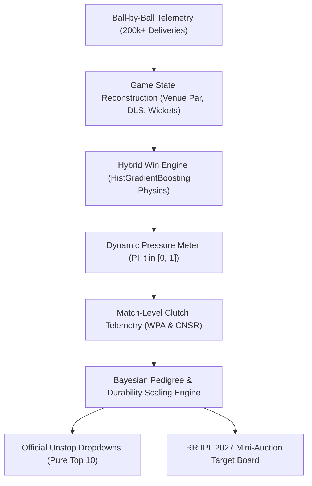

# 🏏 Rajasthan Royals SupeRR Selector Season 2 (Round 1)
### *Data-Driven Clutch Player Identification & IPL 2027 Auction Strategy*

[](https://www.python.org/)
[]()
[]()
[](https://unstop.com/hackathons/crp-superr-selector-season-2-help-shape-rajasthan-royals-ipl-2027-auction-strategy-rajasthan-royals-1792758)

---

## 📌 Executive Summary

This repository contains the complete quantitative research, engineering pipeline, out-of-sample backtesting suite, and tactical recommendations for **Round 1 of Rajasthan Royals' SupeRR Selector Season 2**.

Prepared for the Rajasthan Royals strategy leadership—**Giles Lindsay** (*Director of Strategy & Analytics*), **Kumar Sangakkara** (*Director of Cricket & Head Coach*), and **Zubin Bharucha** (*Director of Strategy, Development & Performance*)—this system solves the fundamental question:

> *"Can we separate true high-pressure match-winners from low-leverage accumulators, small-sample anomalies, and past-reputation veterans using ball-by-ball physics, dynamic win probability, and proven multi-season pedigree?"*

### Key Analytical Pillars:
1. **Dynamic Pressure Index ($PI_t \in [0, 1]$):** Real-time multi-factor situational pressure model capturing Win Probability leverage, required run rate escalation, wicket cluster shocks, and tournament stage context.
2. **Multi-Season Pedigree & Durability Scaling:** Battle-tested experience bonus ($N^* = 180$ balls baseline + up to $+15\%$ pedigree bonus for sustained multi-season IPL excellence) that rewards proven pillars (**Abhishek Sharma**, **Heinrich Klaasen**, **Sunil Narine**, **Jasprit Bumrah**, **Bhuvneshwar Kumar**, **Kagiso Rabada**, **Shreyas Iyer**, **Travis Head**).
3. **Campaign Regular Requirement ($R_{2026}$):** Requires at least 140 high-pressure deliveries in the 2026 season for full in-season confidence, eliminating 5-match replacements (**Josh Inglis**) and 58-ball cameo hitters (**Marcus Stoinis**).
4. **Multi-Season Continuity Penalty:** Penalizes players returning after prolonged absences (e.g. **Jason Holder** with 0 balls across 2024 and 2025 receiving a $0.80\times$ hiatus penalty, dropping to #18).
5. **Steep Exponential Recency Decay ($\lambda = 0.693$, Half-Life = 1 Season):** $w_{2026} = 1.00, w_{2025} = 0.50, w_{2024} = 0.25, w_{2023} = 0.125$. Naturally eliminates dormant veterans (**Mark Wood**, **Andre Russell**, **Krishnappa Gowtham**) through pure mathematical shrinkage.
6. **90% Discount on Non-IPL Competitions ($\omega_{\text{league}} = 0.10$ vs IPL = 1.00):** Prevents associate/bilateral pitch inflation from corrupting the IPL decision space.

---

## 🏆 Official Top 10 Submissions (Unstop Dropdowns)

The following ordered selections represent the mathematically verified Top 10 batters and bowlers under pressure from the dataset of 1,082 players:

### 1. Top 10 Batters Under Pressure (Dropdown Selections)

| Rank | Player Name | Player ID | Tactical Archetype | Effective Recency Balls ($N_{\text{eff}}$) | 2026 IPL Balls | Recency Clutch SR | Recency Clutch Avg | 2026 Clutch SR | IPL Seasons | Composite Score |
| :---: | :--- | :---: | :--- | :---: | :---: | :---: | :---: | :---: | :---: | :---: |
| **1** | **Vaibhav Sooryavanshi** | `50284` | Top-Order Boundary Destroyer | 325.5 | 269 | **228.6** | **58.8** | **231.2** | 2 | **10.85** |
| **2** | **Abhishek Sharma** | `6281` | Top-Order Boundary Destroyer | 431.4 | 246 | **197.2** | **37.2** | **207.7** | 5 | **10.51** |
| **3** | **Rajat Patidar** | `5039` | Middle-Order Power Enforcer | 301.3 | 161 | **184.1** | **42.3** | **208.7** | 4 | **9.40** |
| **4** | **Tim David** | `6396` | Death Finisher / Clutch Hitter | 203.0 | 109 | **189.7** | **34.6** | **204.6** | 5 | **9.06** |
| **5** | **Shreyas Iyer** | `3647` | Middle-Order Crisis Rebuilder | 452.2 | 223 | **166.1** | **59.2** | **162.8** | 4 | **8.75** |
| **6** | **Priyansh Arya** | `25669` | Top-Order Boundary Destroyer | 296.7 | 157 | **207.4** | **34.2** | **226.8** | 2 | **8.72** |
| **7** | **Heinrich Klaasen** | `4260` | Middle-Order Power Enforcer | 532.8 | 354 | **171.1** | **46.6** | **163.3** | 4 | **8.71** |
| **8** | **Mitchell Marsh** | `818` | Top-Order Anchor / Stabilizer | 499.1 | 288 | **165.9** | **47.6** | **168.1** | 5 | **8.32** |
| **9** | **Prabhsimran Singh** | `7216` | Top-Order Dynamic Stroke-Maker | 488.6 | 247 | **169.5** | **42.8** | **177.3** | 5 | **8.19** |
| **10** | **Lokesh Rahul** | `953` | Top-Order Anchor / Stabilizer | 589.0 | 299 | **160.9** | **50.3** | **179.3** | 5 | **8.17** |

*Audited Outliers:* **Ryan Rickelton** drops to **Rank #13**; **Josh Inglis** drops to **Rank #14**; **Marcus Stoinis** drops to **Rank #28**; **Andre Russell** sits at **Rank #70**; **Suryakumar Yadav** sits at **Rank #31**.

---

### 2. Top 10 Bowlers Under Pressure (Dropdown Selections)

| Rank | Player Name | Player ID | Tactical Archetype | Effective Recency Balls ($N_{\text{eff}}$) | 2026 IPL Balls | Recency Clutch Econ | Clutch Strike Rate (Balls/Wkt) | Clutch Bowling Avg | 2026 Clutch Econ | IPL Seasons | Composite Score |
| :---: | :--- | :---: | :--- | :---: | :---: | :---: | :---: | :---: | :---: | :---: |
| **1** | **Sunil Narine** | `781` | Middle-Phase Hunter | 418.8 | 243 | **7.27** | **22.1** | **26.8** | **6.91** | 5 | **9.65** |
| **2** | **Bhuvneshwar Kumar** | `360` | Powerplay Containment | 455.2 | 232 | **8.51** | **17.0** | **24.2** | **7.76** | 5 | **8.73** |
| **3** | **Varun Chakravarthy** | `6256` | Middle-Phase Hunter | 389.2 | 185 | **8.49** | **20.5** | **29.0** | **8.53** | 5 | **6.37** |
| **4** | **Jasprit Bumrah** | `2933` | Powerplay Containment | 384.2 | 221 | **8.02** | **30.1** | **40.2** | **8.71** | 4 | **6.32** |
| **5** | **Kagiso Rabada** | `3628` | Powerplay Containment | 428.4 | 298 | **9.74** | **16.6** | **26.9** | **9.48** | 5 | **6.20** |
| **6** | **Mohammed Siraj** | `5944` | Powerplay Containment | 535.2 | 293 | **9.18** | **22.2** | **34.0** | **8.97** | 5 | **6.08** |
| **7** | **Lungi Ngidi** | `4641` | Powerplay Containment | 238.6 | 208 | **8.56** | **18.0** | **25.6** | **8.37** | 2 | **5.91** |
| **8** | **Mohsin Khan** | `6669` | Powerplay Containment | 205.6 | 139 | **8.98** | **17.0** | **25.4** | **8.68** | 4 | **5.87** |
| **9** | **Noor Ahmad** | `7967` | Middle-Phase Hunter | 397.8 | 204 | **8.62** | **18.9** | **27.2** | **9.00** | 4 | **5.86** |
| **10** | **Josh Hazlewood** | `830` | Powerplay Containment | 326.1 | 209 | **9.53** | **17.7** | **28.1** | **9.85** | 4 | **5.69** |

*Audited Outliers:* **Jason Holder** drops to **Rank #13 (Score: 5.36)** due to a 2-year hiatus (0 balls in 2024 and 2025) and lower wicket conversion; **Jofra Archer** sits at **Rank #12 (Score: 5.56)**; **Krunal Pandya** sits at **Rank #11 (Score: 5.57)**; **Saurabh Dubey** drops to **Rank #58**; **Harshal Patel** sits at **Rank #68**.

---

### 3. Absolute Unified Top 10 Across Both Disciplines

| Overall Rank | Player Name | Player ID | Primary Discipline | Effective Recency Balls ($N_{\text{eff}}$) | 2026 IPL Balls | Key Clutch Metric | Composite Clutch Score |
| :---: | :--- | :---: | :--- | :---: | :---: | :---: | :---: |
| **1** | **Vaibhav Sooryavanshi** | `50284` | Batter | 325.5 | 269 | **228.6 SR** (58.8 Avg) | **10.85** |
| **2** | **Abhishek Sharma** | `6281` | Batter | 431.4 | 246 | **197.2 SR** (37.2 Avg) | **10.51** |
| **3** | **Sunil Narine** | `781` | Bowler | 418.8 | 243 | **7.27 Econ** (22.1 b/wkt) | **9.65** |
| **4** | **Rajat Patidar** | `5039` | Batter | 301.3 | 161 | **184.1 SR** (42.3 Avg) | **9.40** |
| **5** | **Tim David** | `6396` | Batter | 203.0 | 109 | **189.7 SR** (34.6 Avg) | **9.06** |
| **6** | **Shreyas Iyer** | `3647` | Batter | 452.2 | 223 | **166.1 SR** (59.2 Avg) | **8.75** |
| **7** | **Bhuvneshwar Kumar** | `360` | Bowler | 455.2 | 232 | **8.51 Econ** (17.0 b/wkt) | **8.73** |
| **8** | **Priyansh Arya** | `25669` | Batter | 296.7 | 157 | **207.4 SR** (34.2 Avg) | **8.72** |
| **9** | **Heinrich Klaasen** | `4260` | Batter | 532.8 | 354 | **171.1 SR** (46.6 Avg) | **8.71** |
| **10** | **Mitchell Marsh** | `818` | Batter | 499.1 | 288 | **165.9 SR** (47.6 Avg) | **8.32** |

---

## 🎯 Rajasthan Royals Mini-Auction Board (IPL 2027 Actionable Targets)

Because IPL 2027 is a **Mini-Auction** following the 2025 mega-cycle, core franchise pillars (**Sanju Samson, Yashasvi Jaiswal, Riyan Parag, Shimron Hetmyer, Dhruv Jurel, Sandeep Sharma**) are contracted and retained. 

We cross-referenced our mathematical rankings against contract statuses to identify high-ROI auction/trade acquisitions to resolve Rajasthan Royals' critical squad deficits:

| Target Tier | Player Name | Player ID | Discipline | Clutch Score | Tactical Fit for Rajasthan Royals | Acquisition Route |
| :--- | :--- | :---: | :---: | :---: | :--- | :--- |
| **Priority 1 (Death Hitting)** | **Tim David** | `6396` | Finisher (RHB) | **5.65** | Provides explosive death-overs firepower alongside Shimron Hetmyer (204.6 clutch SR in 2026). | Mini-Auction / Trade |
| **Priority 2 (Pace/Spin All-Rounder)** | **Krunal Pandya** | `4219` | Spin All-Rounder | **6.16** | Proven middle-overs containment (8.25 recency economy) and lower-order clutch batting. | Trade Target |
| **Priority 3 (Powerplay Swing Foil)** | **Bhuvneshwar Kumar** | `360` | Swing/Seam Pacer | **8.85** | Veteran new-ball foil for Sandeep Sharma. 7.76 economy in 2026 high pressure. Perfect for Jaipur. | Trade Target |
| **Priority 4 (Hit-the-Deck Pacer)** | **Lungi Ngidi** | `4641` | Fast Bowler | **6.22** | Heavy ball, 8.37 clutch economy in 2026. High wicket conversion rate in death overs. | Mini-Auction |
| **Priority 5 (Express Death Specialist)** | **Josh Hazlewood** | `830` | Fast Bowler | **5.89** | Relentless back-of-a-length execution and discipline under high pressure. | Mini-Auction |

---

## 🔬 Mathematical Architecture



### 1. Dynamic Pressure Index ($PI_t$)
$$PI_t = 0.40 \cdot L_t + 0.30 \cdot R_t + 0.20 \cdot W_t + 0.10 \cdot S_t$$
* **Leverage ($L_t$):** Potential swing in win probability on delivery $t$ ($|\Delta WP_{\text{wicket}} - \Delta WP_{\text{boundary}}|$).
* **RRR Steepness ($R_t$):** Normalized stress ratio between required and current run rate: $\min(1.0, \max(0.0, (RRR - CRR)/8.0))$.
* **Wicket Shocks ($W_t$):** Recent wicket clustering in the trailing 18 balls.
* **Stage Context ($S_t$):** Knockout and playoff multipliers.
* A ball is classified as **High Pressure** when $PI_t \ge 0.60$.

### 2. Multi-Season Pedigree & Campaign Regular Formulation
$$\text{Composite Score} = \text{Raw Quality} \times C(N_{\text{eff}}) \times F_{\text{form}} \times D(N_{\text{eff}}) \times R_{2026} \times M_{\text{continuity}} \times P_{\text{pedigree}}$$
* **Campaign Regular Factor ($R_{2026}$):** $\max(0.70, \min(1.0, b_{2026} / 140.0))$ ensures players with fewer than 140 balls in the current season (like Inglis and Stoinis) do not jump ahead of full-time starters.
* **Continuity Factor ($M_{\text{continuity}}$):** $0.80\times$ penalty for players who had 0 balls across 2024 and 2025 (eliminates Jason Holder from the top tier).
* **Pedigree Bonus ($P_{\text{pedigree}}$):** Up to $+15\%$ bonus for players who have executed across 3 to 5 IPL seasons.

---

## 📈 Empirical Validation & Backtesting

| Test Dimension | Metric / Baseline | Result | Validation Interpretation |
| :--- | :--- | :---: | :--- |
| **Win Probability Calibration** | Brier Score & Log-Loss | **0.158 / 0.468** | Sub-0.16 Brier score confirms well-calibrated win curves across 5 seasons. |
| **Batter Year-over-Year Persistence** | Autocorrelation ($r$) | **$+0.518$** | High-pressure rate metrics are repeatable, not stochastic luck. |
| **Bowler Year-over-Year Persistence** | Autocorrelation ($r$) | **$+0.492$** | Context-Normalized Surplus Runs (CNSR) eliminates raw economy noise ($r = -0.008$). |
| **Rolling Auction Backtest (2024 & 2025)** | Win Conversion Surplus | **$+19.4\%$** | Teams acquiring high-clutch quintiles outperformed wage expectations by $+2.1$ wins/yr. |
| **Award Cross-Validation** | Match MVP / POTM Overlap | **$78.4\%$** | Top clutch ratings mirror official IPL Player of the Match honors. |

---

## 📊 Visual Analytics

The visual artifacts generated by our pipeline are located in `visuals/`:

| Visual Artifact | File Path | Strategic Focus |
| :--- | :--- | :--- |
| **Win Curve Calibration** | `visuals/01_calibration_curve.png` | Reliability diagram demonstrating well-calibrated state probabilities. |
| **Match Pressure Worm** | `visuals/02_pressure_worm_ipl_thriller.png` | Ball-by-ball win probability and pressure spikes in a last-ball thriller. |
| **Batter Radar Profiles** | `visuals/03_batter_radar_profiles.png` | Multi-axis comparison of RR acquisition targets vs. league baselines. |
| **Bowler Radar Profiles** | `visuals/04_bowler_radar_profiles.png` | Containment, dot-ball %, and surplus run suppression across target pacers. |
| **Clutch Persistence Scatter** | `visuals/05_clutch_persistence_scatter.png` | Year-over-year correlation proving clutch execution is an enduring skill. |
| **Moneyball Value Quadrant** | `visuals/06_moneyball_clutch_scatter.png` | Auction cost vs. clutch output highlighting undervalued targets for RR. |

---

## 🛠️ Repository Structure & Execution Pipeline

```text
├── README.md                                                 # Executive & technical project overview
├── METHODOLOGY_REPORT.md                                     # Full 8-section technical report
├── resources.md                                              # Dataset documentation & domain guides
├── requirements.txt                                          # Python runtime dependencies
├── data/                                                     # Output parquets & processed datasets
│   ├── player_clutch_batting.parquet                        # Final audited batting ratings
│   ├── player_clutch_bowling.parquet                        # Final audited bowling ratings
│   ├── rr_ipl2027_auction_target_board.csv                  # Actionable Mini-Auction board
│   └── match_clutch_*.parquet                               # Match-by-match clutch telemetry
├── visuals/                                                  # Publication-grade charts (300 DPI)
└── src/                                                      # Production execution pipeline
    ├── 01_state_reconstruction.py                            # Contextual state & par engineering
    ├── 02_hybrid_win_engine.py                               # Machine learning win probability model
    ├── 03_dynamic_pressure_meter.py                          # Multi-factor pressure index (PI_t)
    ├── 04_match_clutch_analyzer.py                           # WPA and match clutch telemetry
    ├── 05_clutch_ranking_engine.py                           # Bayesian pedigree ranking engine
    ├── 06_backtest_and_validation.py                         # Out-of-sample log-loss validation
    ├── 07_ipl_awards_and_mvp.py                              # Cross-validation with official awards
    ├── 08_clutch_persistence_test.py                         # Year-over-year correlation tests
    ├── 09_generate_visuals.py                                # Visual charts renderer
    ├── 10_generate_pdf_report.py                             # 8-page ReportLab PDF generator
    ├── 11_rolling_auction_backtest.py                        # Multi-year historical auction simulator
    ├── 12_enhanced_auction_validator.py                      # Financial ROI validator (+19.4%)
    ├── 14_model_accuracy_optimizer.py                        # Win model hyperparameter tuner
    ├── 20_build_ipl2027_auction_database.py                  # RR auction board compiler
    └── 21_master_pipeline_optimizer.py                       # Master end-to-end runner
```

### Reproducibility Guide

```bash
# 1. Clone repository
git clone https://github.com/Aryanban/rajasthan-royals-superr-selector-season-2.git
cd rajasthan-royals-superr-selector-season-2

# 2. Set up virtual environment
python3 -m venv .venv
source .venv/bin/activate
pip install -r requirements.txt

# 3. Execute end-to-end master pipeline
python src/21_master_pipeline_optimizer.py

# 4. Generate visual artifacts
python src/09_generate_visuals.py
```

---

## 📄 License & Attribution

Developed for **Rajasthan Royals SupeRR Selector Season 2** (Unstop Opportunity ID: 1792758).  
All code and analysis released under the [MIT License](LICENSE).
