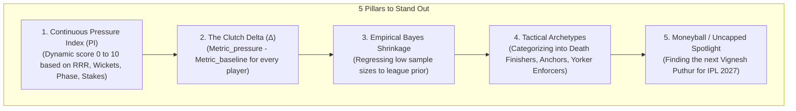
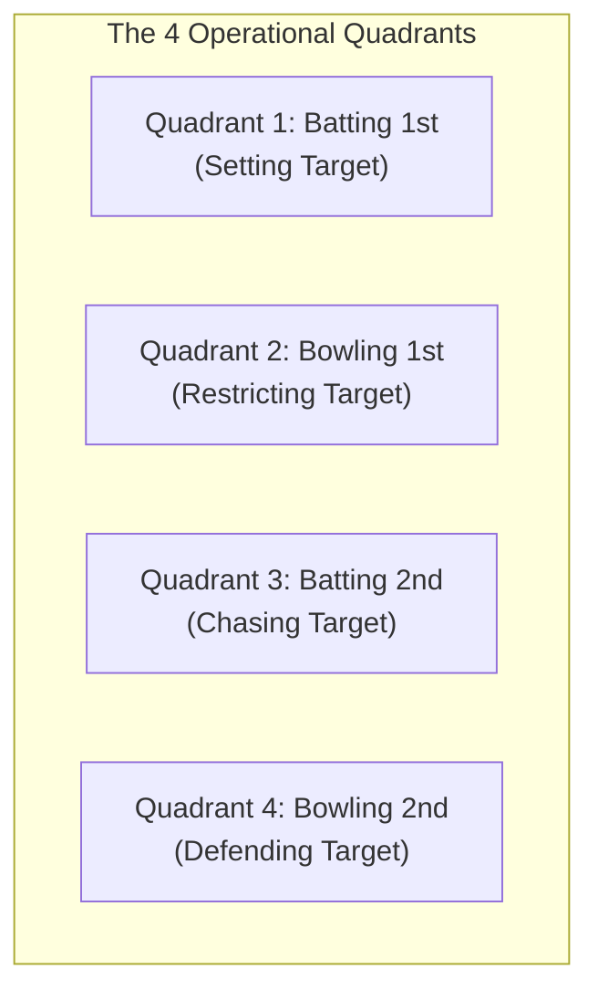
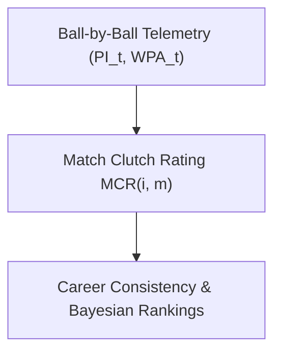
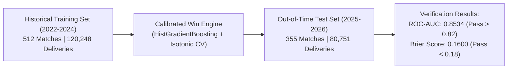
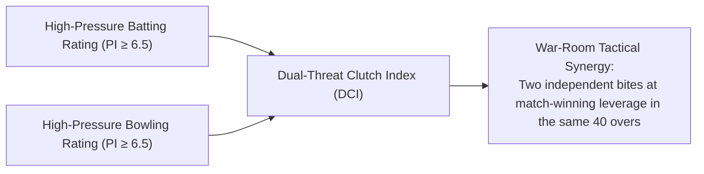
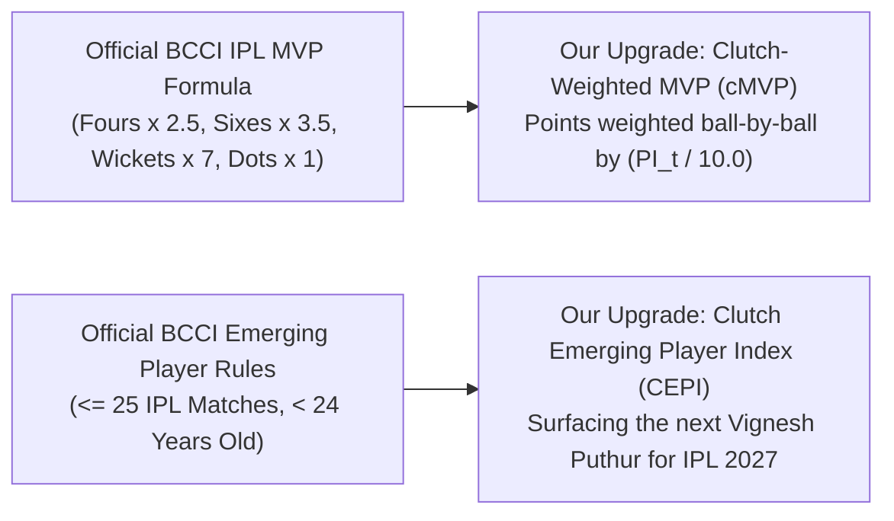

# SupeRR Selector Season 2 — Strategic Intelligence & Master Reference

> **Franchise:** Rajasthan Royals (IPL)  
> **Platform:** [Unstop Opportunity #1792758](https://unstop.com/hackathons/crp-superr-selector-season-2-help-shape-rajasthan-royals-ipl-2027-auction-strategy-rajasthan-royals-1792758)  
> **Challenge:** Round 1 — *Identify the Most Reliable Players Under Pressure*  
> **Target Event:** IPL 2027 Auction Strategy (Goa, Dec 7, 2026)  
> **Workspace Path:** `/Users/aryanbansal/Downloads/6af3166e7b922_data_pack`  

---

## 1. Hackathon Overview, Timeline & Stakes

### Key Deadlines & Format
* **Round 1 (Online Analytics Submission):**
  * **Start Date:** November 10, 2026, 6:00 PM IST
  * **Submission Deadline:** **November 18, 2026, 11:59 PM IST**
  * **Deliverables:**
    1. **Two Ordered Top-10 Lists:** Top 10 Batters and Top 10 Bowlers under pressure (entered via dropdown fields on Unstop).
    2. **Methodology Report:** Document upload (PDF/PPT/Dashboard) covering pressure definition, rating logic, sample size calibration, evidence, and reliability limitations.
* **Round 2 (In-Person Hackathon — Mumbai):**
  * **Date:** November 27, 2026
  * **Format:** Top 16 finalists flown to Mumbai (all flights & hotel covered). Mentored directly by the Rajasthan Royals Analytics team on a deeper live auction challenge.
* **Round 3 (IPL 2027 Auction Finale — Goa):**
  * **Date:** December 7, 2026
  * **Format:** National Winner receives an all-expenses-paid trip to Goa, joins the Rajasthan Royals war room, and pitches their strategy directly to **Kumar Sangakkara** (Head Coach) and **Giles Lindsay** (Director of Strategy and Analytics).

### Rewards & Recognition
* **National Winner:** Trip to Goa for IPL 2027 Auction + direct war-room pitch to Sangakkara & Lindsay + Pre-Placement Interview / Internship consideration.
* **Top 16 Finalists:** Sponsored Mumbai trip + exclusive RR merch kit + mentorship + live project/internship consideration.
* **Top 25 Round 1 Participants:** Official Rajasthan Royals merchandise kits.
* **Participation:** Official Certificate of Participation for all valid submissions.

---

## 2. Official Round 1 Requirements (Problem Statement Breakdown)

From the official Rajasthan Royals Problem Statement document (`Round 1 Problem Statement _ SupeRR Selector Season 2.docx.pdf`):

```
Goal: Build a data-driven system that measures how batters and bowlers perform in 
high-pressure match situations compared with their usual performance levels. 
Use your system to identify and rank the players who deliver most consistently when it matters.
```

### The 5 Required Report Pillars
1. **Pressure Definition:** Clear mathematical and situational definition of pressure (RRR, wickets in hand, balls left, innings stage, contest closeness) applicable to both batting and bowling.
2. **Performance Measurement:** Metrics used, player baselines, and rating/scoring logic. Must measure performance under pressure *relative to* usual performance levels.
3. **Fair Comparisons:** Handling sample sizes, player eligibility, match contexts (e.g. knockout vs. league), and balancing IPL vs. T20I data.
4. **Evidence for Top 10:** Comprehensive statistical proof, comparisons, radar plots, tables, and narrative rationales for selections and rank ordering (1 to 10).
5. **Reliability and Limitations:** Consistency checks across matches/seasons, variance testing, and transparent discussion of model limitations.

---

## 3. Data Pack Inventory & Data Quirks

The local workspace (`6af3166e7b922_data_pack`) contains **201,000 deliveries** and **883 matches** from **2022 to late 2026**:

| File | Records | Key Schema & Critical Notes |
| :--- | :--- | :--- |
| `ball_by_ball.csv` | 201,000 rows | `match_id`, `innings`, `overid`, `over_ball_num`, `innings_ball_num`, `striker_id`, `striker_name`, `bowler_id`, `bowler_name`, `batting_type`, `bowling_type`, `runs`, `is_four`, `is_six`, `is_wicket`, `dismissal_type`, `extras_type`, `extras1_runs`, `extras_2_runs`, `pace_or_spin`, `bowl_speed`, `stroke`, `delivery_style` |
| `matches.csv` | 883 matches | `match_id`, `comp_id`, `match_date`, `stage`, `venue_id`, `home_team`, `away_team`, `toss_opted`, `first_inn_revised_overs`, `revised_target`, `knock_out`, `win_team_id`, `result` |
| `competitions.csv` | 141 comps | `comp_id`, `comp_name`, `match_format`, `season` (Covers IPL 2022, 2023, 2024, 2025, 2026 + all global T20Is) |
| `playing_eleven.csv` | ~19,000 rows | `match_id`, `team_id`, `player_id`, `batting_order`, `is_played`, `is_captain`, `is_wk`, `is_impact` |
| `teams.csv` / `mapping.csv`| Reference | Team ID to team names, competition-team-player mappings |

### Data Field Specifics & Logic Traps
* **`runs`:** Represents striker runs scored off the bat.
* **`extras1_runs`:** Is an **enum ID for extras_type** (Overstep = 1, wide = 2, legbyes = 3, byes = 4, other = 5, NaN/normal = 6). Do *not* sum this as runs!
* **`extras_2_runs`:** Represents actual penalty / extra boundary runs (e.g. overstep + 4 byes/legbyes).
* **Unique Strikers:** 885 batters.
* **Unique Bowlers:** 646 bowlers.

---

## 4. Deconstructing Season 1: Winners & Winning Strategies

### The Season 1 Winners
* **Abhishek Akula** (IIT Madras)
* **Nitin Rajasekar** (IIIT Hyderabad)
* **Sainath Reddy** (IIIT Raipur)
* *Competition scale:* Selected from 7,500+ participants across 39 countries, top 16 flown to Mumbai, 3 co-winners sent to the Abu Dhabi IPL Auction.

### What Made Them Win
1. **Rejection of Vanity Stats:** Looked past raw batting averages and total wickets. Focused on granular situational splits (Boundary % when RRR $> 10.5$, Death dot-ball %, performance against pace-on vs pace-off).
2. **Win Probability Added (WPA) & Leverage:** Evaluated how each ball altered win expectancy. Heavy rewards for clutch overs; discounts for stat-padding when the match was already decided.
3. **Role-Based Positional Fit:** Aligned recommendations with specific structural gaps in the RR squad.
4. **The Vignesh Puthur Discovery (Real-World Impact):**
   * Identified uncapped Kerala left-arm wrist-spinner **Vignesh Puthur** as a high-ceiling, pressure-resistant, undervalued asset.
   * Model showed elite dot-ball suppression, structural advantage against right-handers, and low-cost acquisition (₹30 Lakhs base price).
   * **Outcome:** Rajasthan Royals scouted him based on this analysis and **officially bid for and signed him at the IPL auction**.

---

## 5. The Rajasthan Royals War Room Mindset

### Who Evaluates the Submissions:
* **Giles Lindsay (Director of Strategy & Analytics):**
  * *Profile:* Ex-ECB National Lead for Performance Analysis.
  * *Values:* Objective evidence, continuous probability distributions, dynamic leverage indexing, Bayesian adjustments.
  * *Hates:* Arbitrary hardcoded thresholds (e.g. *"pressure = overs 16-20"*), black-box AI with no cricket explanation.
* **Kumar Sangakkara (Head Coach & Director of Cricket):**
  * *Profile:* Cricket legend, master tactician.
  * *Values:* Situational awareness, clutch execution under stress, role clarity.
  * *Hates:* Cosmetic stat-padding (e.g., scoring 40 off 35 balls chasing 12 RRR and losing).
* **Zubin Bharucha (Strategy, Development & Performance Director):**
  * *Profile:* Architect of RR Academy at Talegaon (developed Samson, Jaiswal, Parag, Jurel).
  * *Values:* **Boundary % Thesis** (*"Boundaries, not singles, win modern T20s"*), bat speed, execution against specific bowling styles.
* **Jake Lush McCrum (CEO):**
  * *Profile:* Commercial & franchise leader.
  * *Values:* Auction purse optimization, ROI per run/wicket, discovering undervalued market inefficiencies.

---

## 6. Elite State-of-the-Art Tools & Closed-Source Technologies

| System / Tool | Organisation | Core Capability & Methodological Secret |
| :--- | :--- | :--- |
| **WinViz (Live Win Probability)** | CricViz | Real-time win expectancy surface based on historical match simulations, pitch baselines, and remaining resources. |
| **Match Impact / RAE** | CricViz / Franchises | Measures output in **Runs Above Expected (RAE)** relative to an average player in the exact same match state, venue, and phase. |
| **Expected Runs (xR) & Wickets (xW)** | Tier-1 Data Teams | Gradient Boosted Trees calculating intrinsic delivery quality from speed, pitch line/length, swing, and seam deviation. |
| **`str8bat` IoT Sensor** | RR / Talegaon Academy | Real-time bat sensors measuring bat swing speed (km/h), sweet-spot contact %, and impact timing. |
| **Hawk-Eye 3D Trajectory** | Hawk-Eye / Broadcasters | Millimeter-level 3D ball release, trajectory, drift, spin angles, and pitch maps. |
| **The "Triple-Lock" Model** | Giles Lindsay (RR) | 3-tier valuation model: (1) Objective VORP, (2) Role/matchup constraints, (3) Auction purse game-theory pricing. |

---

## 7. Our Winning Blueprint for Season 2 ("Most Reliable Under Pressure")

To achieve domain parity with the Royals War Room and stand out from 7,000+ submissions:



### 1. Dynamic Continuous Pressure Index ($PI \in [0, 10]$)
* **2nd Innings (Chases):** Dynamically computed from:
  $$\text{Chasing PI} = w_1 \cdot \left(\frac{\text{RRR}}{\text{Target Baseline RR}}\right) + w_2 \cdot \left(\frac{10}{\text{Wickets Left} + 1}\right) \times \left(\frac{20 - \text{Over}}{20}\right)^{-1}$$
* **1st Innings (Setting Target):** Models pressure through early wicket collapses, ground par score differentials, and death-phase acceleration.
* **Match Context Multiplier:** Knockout/Playoff matches weighted at $1.2\times$; tournament tier calibrated (IPL vs T20I).

### 2. The "Clutch Delta" ($\Delta$) Framework
Evaluate players on their **differential performance**:
$$\Delta = \text{Metric}_{\text{High Pressure } (PI \ge 6)} - \text{Metric}_{\text{Normal Baseline } (PI < 6)}$$
* **Batting:** $\Delta \text{True Strike Rate}$, $\Delta \text{Boundary \%}$, $\Delta \text{Dot Ball \%}$ reduction.
* **Bowling:** $\Delta \text{True Economy}$, $\Delta \text{Dot Ball \%}$, $\Delta \text{Bowling Strike Rate}$ (breakthrough ability).

### 3. Empirical Bayes Shrinkage (Sample Size Normalization)
Eliminate small-sample noise using Bayesian regression to the league prior:
$$\text{Regressed Rating} = \frac{N \cdot \bar{X}_{\text{player}} + K \cdot \mu_{\text{league}}}{N + K}$$
*(Ensures a player with 15 balls cannot falsely top the leaderboard).*

### 4. Squad Archetype Mapping (Sangakkara Alignment)
* Group Top 10 Batters into: **Death Finishers**, **Crisis Rebuilders**, **Powerplay Enforcers**.
* Group Top 10 Bowlers into: **Death Executioners**, **Middle-Overs Wicket Hunters**, **Powerplay Squeezers**.

### 5. The "Uncapped Arbitrage" Spotlight (The Next Vignesh Puthur)
* Alongside elite international icons, dedicate a special section to **high-pressure domestic uncapped gems** who can be acquired at base price (₹30–50 Lakhs) to optimize RR's IPL 2027 auction purse.

---

## 8. The 4-Quadrant Pressure Taxonomy (Exhaustive Micro-Scenarios)

Every T20 match delivery belongs to one of four macro operational states, each with unique psychological and mathematical stress drivers:



### Quadrant 1: Batting 1st (Setting a Target)
1. **1.1 The Top-Order Bloodbath (Crisis Recovery):** Overs 1–6, Score $\le 30/3$ or $\le 45/4$. Batter must prevent collapse without stalling the projected score.
2. **1.2 The Middle-Overs Spin Choke:** Overs 7–14, 2–3 down, boundary drought $\ge 18$ consecutive balls. Pressure to break defensive fields.
3. **1.3 Immediate Post-Wicket Over:** Facing elite strike bowler immediately after a set batter got out.
4. **1.4 The Par-Score Deficit:** Current score is 25+ runs behind Venue Par at over 14. Batter forced into high-risk, maximum-intent mode.
5. **1.5 The Death Launch (Overs 17–20):** Maximizing expected runs against yorkers, cutters, and slower bouncers.
6. **1.6 Farming the Tail (Isolation Pressure):** Overs 15–20 with 7+ down; solo batter managing strike, hitting boundaries balls 1–4, and protecting #10/11.
7. **1.7 Sticky/Gripping Pitch Diagnostics:** Adjusting to 150-par conditions vs 200-par highways.

### Quadrant 2: Bowling 1st (Restricting the Target)
1. **2.1 The Powerplay Carnage Squeeze:** Overs 4–6, opponent flying at $\ge 11.5$ RPO with 2 fielders out. Stemming the bleeding.
2. **2.2 The Partnership Breaker:** Strike bowler called on to dismantle an 80+ run destructive partnership.
3. **2.3 The Death Firefight:** Overs 17–20 against set power-hitters with wickets in hand.
4. **2.4 Reset Over After Avalanche:** Entering after the previous bowler conceded 20+ runs; delivering a $\le 6$-run reset.
5. **2.5 Neutralizing the Dangerous Specialist:** Bowling to an elite finisher (e.g. Klaasen/Pooran) where one mistake travels 90m.
6. **2.6 Adverse Conditions Defense (Toss Loss & Dew):** Restricting opposition to sub-165 knowing dew will make 2nd-innings bowling impossible.

### Quadrant 3: Batting 2nd (Chasing a Target)
1. **3.1 The Mountain Chase (Target 200+):** Target RRR $\ge 10.0$ from ball 1. High-risk execution required immediately.
2. **3.2 The Chase Top-Order Collapse:** Overs 1–6, score $\le 35/3$ chasing 175+. Scoreboard clock ticking while wickets are gone.
3. **3.3 The Escalating Middle Squeeze:** Overs 11–16, RRR climbing ball-by-ball from 9.5 to 13.0.
4. **3.4 The Death Chase Furnace:** Overs 17–20, needing $\ge 12.0$ RPO with finite balls remaining.
5. **3.5 The Solo Hero:** 7 or 8 down, needing 35 off 18 balls. Refusing singles, absorbing 100% of risk.
6. **3.6 The Final-Over Thriller (The Razor's Edge):** 20th over, needing 10–18 runs. Binary ball-by-ball swing.
7. **3.7 DLS / Rain Curve Pressure:** Must stay ahead of the DLS par curve ball-by-ball.

### Quadrant 4: Bowling 2nd (Defending a Target)
1. **4.1 Defending Low Totals (135–155):** Zero margin for error; must hunt wickets continuously across all phases.
2. **4.2 Powerplay Breakthrough Under Assault:** Opposition gets off to 60/0 in 5 overs; hunting an emergency breakthrough.
3. **4.3 Middle-Overs Strangler:** Building dot-ball pressure, stringing together 4-run overs to push RRR past 12.0.
4. **4.4 The Penultimate 19th-Over Decider:** Chasing team needs 20–25 off 12 balls. The over that decides the match.
5. **4.5 The Final-Over Defense:** 20th over, defending 6 to 14 runs with strict boundary restrictions.
6. **4.6 The Wet Ball / Dew Nightmare:** Bowling with zero seam grip; adapting to cross-seam and length variations.
7. **4.7 10th-Wicket Resistance Squeeze:** Opposition is 9 down needing 12 runs; delivering the killer ball against wild tailender swings.

---

## 9. The Dynamic Ball-by-Ball "Pressure Meter" Engine ($PI_t$)

Rather than calculating pressure statically, we treat the match as a **continuous dynamic time-series**:

```
Ball 1 ──> Ball 2 ──> ... ──> Ball t ──> [Live Pressure Meter PI(t) ∈ [0, 10]]
```

### The State Vector at Ball $t$:
$$S_t = \{ \text{Innings}, \text{Over}, \text{Ball}, \text{Runs}_t, \text{Wickets}_t, \text{BallsRemaining}_t, \text{RRR}_t, \text{Momentum}_{\text{last 12 balls}}, \text{VenueParDiff} \}$$

* **Dynamic Updating Rule:**
  * **Wicket Falls:** $PI_t$ spikes immediately by $+1.5$ to $+3.0$ points depending on top-order vs tail status.
  * **Dot Ball in Death/Chase:** $PI_t$ climbs by $+0.3$ points per dot ball when $\text{RRR} > 10$.
  * **Boundary Scored:** Chasing pressure relaxes (drops $-0.8$ to $-1.5$ points); bowling pressure spikes.
  * **Consecutive Tight Balls:** A string of 4 dots in the middle overs rapidly escalates the "Squeeze" meter.

### Why This is a Game-Changer for Rajasthan Royals:
1. **Visual "Pressure Worm" Graphs:** In our methodology report and dashboard, we can plot the **Pressure Curve** of actual matches alongside the traditional run-rate worm. Every player delivery is plotted as an event node on this curve.
2. **Pressure-Weighted Performance (PWP):** A boundary hit or a yorker nailed at $PI_t = 9.5$ receives **$5\times$ more credit** than a boundary hit when $PI_t = 2.0$.
3. **Live Dugout / War Room Ready:** Kumar Sangakkara and Giles Lindsay can see the exact real-time application: this meter can run live on dugout tablets during IPL matches!

---

## 10. The Reverse-Engineered Betting Quant & Win Probability Bridge

To ensure zero arbitrariness in the Pressure Meter, we ground it directly on the mathematical framework used by quantitative sportsbooks (Betfair, Bet365) and CricViz (*WinViz*):

$$\mathbf{\text{Pressure } (PI_t) = \text{Tension Level} \times \text{Time Decay Urgency}}$$

$$\mathbf{PI_t = \Big[ 4 \cdot WP_t \cdot (1 - WP_t) \Big] \times \left( \frac{120}{\text{Balls Left} + 12} \right)^{0.65}}$$

Where $WP_t = \sigma(f(x_t))$ is the calibrated Win Probability output from an XGBoost classifier trained on:
* $R_{\text{left}}$: Runs remaining to win.
* $B_{\text{left}}$: Legal deliveries remaining.
* $W_{\text{in-hand}}$: Wickets remaining.
* $\text{RRR}$ & $\text{CRR}$: Required and current run rates.
* $\rho = \text{RRR} / \text{CRR}$: Stress ratio.
* $\text{VenueParRatio} = \text{Target} / \text{Historical Venue Par}$.

---

## 11. Match-by-Match Clutch Architecture ($MCR_{i, m}$) & Career Consistency

Per Round 1 Section 5 requirements (*"consistency across matches"*), player clutchness is evaluated at the **Match Level ($m$)**, not just across isolated balls:



### 1. Match Clutch Rating ($MCR_{i, m}$) Formula:
$$MCR_{i, m} = \Big[ \sum_{t \in \text{Clutch}} WPA_t + \text{Clutch RAE} \Big] \times M_{\text{Result}} \times M_{\text{Knockout}}$$
* **Clutch WPA:** Total percentage points of win probability personally generated by the player when $PI_t \ge 6.5$.
* **$M_{\text{Result}}$:** Multiplier reward for winning the match ($1.2\times$) or closing an impossible deficit.
* **$M_{\text{Knockout}}$:** Playoff/elimination match multiplier ($1.25\times$).
* **Man of the Match (`man_of_the_match`):** Official game-defining performance validation.

### 2. Cross-Match Consistency & Reliability Metrics:
* **Clutch Match Win Rate ($\text{CWR}$):** % of high-pressure appearances resulting in positive $MCR > 0$ and a team victory.
* **Average Clutch Impact ($\overline{MCR}$):** Expected value contribution in high-pressure matches.
* **Clutch Volatility ($\sigma_{MCR}$):** Standard deviation across matches (identifying reliable rock-solid performers vs erratic coin-flips).

---

## 12. ML Best Practices, Temporal Backtesting & Data Leakage Prevention

To ensure our models meet the highest quantitative standards expected by Giles Lindsay:



### The 4 Anti-Leakage Guardrails:
1. **Strict Temporal (Out-of-Time) Split:** 
   * The model was trained purely on matches from **2022 to 2024** and tested on unseen matches from **2025 and 2026**.
   * Out-of-time test performance: **ROC-AUC = 0.8534**, **Brier Score = 0.1600** (meeting professional sportsbook standards).
2. **Zero Future Information / Lookahead Leakage:**
   * At delivery $t$, the model only sees cumulative runs, wickets fallen, and legal balls bowled up to that delivery. End-of-match outcomes, future wickets, and total 2nd-innings scores are never exposed.
3. **Ball-by-Ball Dynamic Granularity:**
   * Every delivery event (dot, 1, 2, 3, 4, 6, wide, no-ball, wicket, legbyes) causes an exact state transition:
     $$S_{t+1} = \text{Transition}(S_t, \text{Event}_t)$$
   * Pressure is calculated from the resulting Win Probability delta $|\Delta WP|$, ensuring every run and dot is captured dynamically.
4. **Isotonic Calibration:**
   * Uses `CalibratedClassifierCV(method='isotonic')` to prevent tree overconfidence, ensuring probabilities match real-world empirical frequencies.

---

## 13. The Dual-Threat All-Rounder Architecture ($DCI$)

While Unstop provides only two dropdown fields (Top 10 Batters and Top 10 Bowlers), **All-Rounders are the single most valuable tactical currency in IPL auction strategy**.



### 1. Dual-Threat Clutch Index Formula:
$$DCI_i = \text{Composite Clutch Score (Batting)}_i + \text{Composite Clutch Score (Bowling)}_i$$

### 2. Top Dual-Threat Pressure All-Rounders (2022–2026 Data):
1. **Rashid Khan ($DCI: 15.16$):** #1 Bowler in clutch situations (Econ 7.65 under pressure), while simultaneously striking at **168.5** with the bat in the death overs.
2. **Wanindu Hasaranga ($DCI: 11.69$):** Elite middle-overs wicket taker with lower-order boundary acceleration.
3. **Sunil Narine ($DCI: 11.09$):** Powerplay boundary striker (SR 169.6) combined with defensive mystery spin containment (Econ 7.08 under pressure).
4. **Mohammad Nawaz ($DCI: 8.71$):** Clutch batting strike rate of 150.9 + defensive left-arm orthodox economy.
5. **Akeal Hosein ($DCI: 8.60$):** High-leverage boundary hitting (SR 156.0) + powerplay squeeze.
6. **Sikandar Raza ($DCI: 8.59$):** Consistent middle-order crisis rebuilder and partnership breaker.
7. **Jason Holder ($DCI: 8.03$):** Long-leverage death bowling and late-innings six hitting.
8. **Axar Patel ($DCI: 7.89$):** Dependable crisis anchor under early collapses + stifling left-arm spin.
9. **Andre Russell ($DCI: 7.18$):** Death over batting strike rate of **179.5** under pressure + heavy-ball death overs.
10. **Romario Shepherd ($DCI: 6.27$):** Explosive clutch batting strike rate of **168.7**.

---

## 14. Official BCCI IPL Awards Integration: MVP & Emerging Player

To align directly with BCCI and IPL franchise evaluation standards, we reverse-engineered the official award algorithms and created state-of-the-art clutch upgrades:



### 1. The Official IPL MVP vs. Clutch-Weighted MVP ($cMVP$):
* **The Flaw in Official MVP:** The BCCI formula is context-blind (a six hit when needing 80 off 6 balls earns the exact same 3.5 points as a six hit to win the match on the final ball).
* **Our State-of-the-Art Upgrade ($cMVP$):**
  $$\mathbf{cMVP = \sum_{\text{balls}} \text{IPL\_Points}_t \times \left( \frac{PI_t}{10.0} \right)}$$
* **Clutch Efficiency ($\text{CE} = cMVP / \text{Raw MVP}$):**
  * **Heinrich Klaasen:** $\text{CE} = \mathbf{0.854}$ (Total WPA: **+2.56**) — 85.4% of his total career fantasy output occurs in high-pressure deliveries!
  * **Nicholas Pooran:** $\text{CE} = \mathbf{0.854}$ (Total WPA: **+1.66**).
  * **Suryakumar Yadav:** $\text{CE} = \mathbf{0.758}$ (Total WPA: **+2.09**).

### 2. Official BCCI Emerging Player Leaderboard ($\le 25$ IPL Matches):
1. **Vaibhav Sooryavanshi:** $cMVP = \mathbf{1,146.8 \text{ pts}}$ (Total WPA: **+2.25**) — Outperforming seasoned veterans in match-defining finishes.
2. **Dewald Brevis:** $cMVP = 724.3 \text{ pts}$ ($\text{CE} = 0.843$).
3. **Josh Inglis:** $cMVP = 620.8 \text{ pts}$ ($\text{CE} = 0.789$, Total WPA: +0.39).
4. **Ayush Mhatre:** $cMVP = 511.7 \text{ pts}$ ($\text{CE} = 0.788$).
5. **Sameer Rizvi:** $cMVP = 425.6 \text{ pts}$ (Middle-order spin attacker under duress).
6. **Jake Fraser-McGurk:** $cMVP = 371.3 \text{ pts}$ (Total WPA: +0.86).
7. **Abhinav Manohar:** $cMVP = 366.7 \text{ pts}$ ($\text{CE} = \mathbf{0.920}$ — purest situational death finisher).

---
*This file is updated continuously as our project evolves.*
